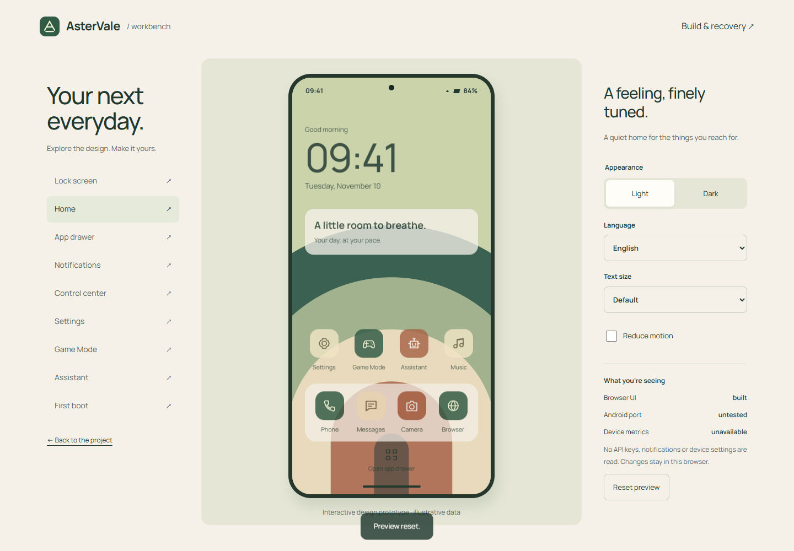

# AsterVale

A custom Android 16 project for Samsung Galaxy A51 **SM-A515F / a51 / Exynos 9611**.

**Source and interactive prototype only. No flashable AsterVale ROM has been built. Every Android feature is untested on hardware.** Never flash the source archive or website archive.

## Try the design

Run `python -m http.server 4173 --directory site --bind 127.0.0.1` and open [the local preview](http://127.0.0.1:4173/preview.html). No package installation or API key is needed. Nine screens, light/dark themes, Arabic/RTL, font scaling, quick settings, per-app profile storage, assistant consent and setup choices. All device data in the preview is illustrative.

## Project state

| Area | Evidence label | What exists |
| --- | --- | --- |
| Web prototype | built | Runnable browser source; see validation report for checks actually run |
| Design system | built | Tokens, original icons/wallpaper, OFL fonts |
| Device build | untested | Pinned source manifest and Linux build orchestration; compilation blocked on host and blobs |
| Native control panel | untested | Soong Java source; not compiled |
| CPU/GPU/thermal/ZRAM | untested | Read-only discovery and policy specification; no tuning enabled |
| AI assistant | untested | Local action preview source; remote inference and notification summarization not integrated |
| Editions / OTA | untested | Product selection and release gates; no published update |
| Owner testing | untested | No test reports submitted |

Read [STATUS](STATUS.md), [base research](docs/BASE_RESEARCH.md), [build setup](docs/BUILD.md), [recovery](docs/RECOVERY.md), [features](docs/FEATURES.md), [AI policy](docs/AI.md), [validation](docs/VALIDATION.md) and [contributing](CONTRIBUTING.md).

Initial base: [LineageOS 23.2](https://github.com/LineageOS/android/tree/lineage-23.2) plus [Exynos9611Development](https://github.com/Exynos9611Development). Independent unofficial project, unaffiliated with Samsung, Google or LineageOS. Kernel stays on the community manifest's **AOSP** branch; no blind branch/version substitution. Android 17 is deferred until baseline boot and a source-level compatibility audit.

Original project source is Apache-2.0; upstream kernel remains GPL-2.0-only and all third-party notices remain intact. Fonts are OFL. No proprietary vendor repository is mirrored or included in our manifest. See [LICENSE](LICENSE) and [NOTICE](NOTICE).
